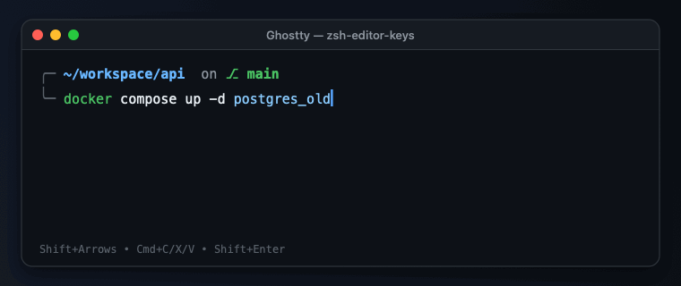

# zsh-editor-keys

[](https://github.com/ga2631/zsh-editor-keys/actions/workflows/ci.yml)
[](LICENSE)

Bring **VS Code / modern GUI editor text-editing** to your Zsh command line — zero external dependencies, cross-platform OS clipboard (`Cmd+C/X/V` & `Ctrl+Shift+C/X/V`), multi-line `Shift+Arrow` selection, and `Shift+Enter` newlines.

<p align="center">
  
</p>

Built for modern GPU terminals (**Ghostty, Kitty, WezTerm, iTerm2, Alacritty, Foot**) and compatible with **Oh My Zsh, Zinit, Antidote, `zsh-autosuggestions`, `fast-syntax-highlighting`, and `zsh-dropdown`**.

---

## Features

* **Full `Shift + Arrow` Selection** — Character (`Shift + ←/→`), multi-line (`Shift + ↑/↓`), word (`Shift + Option` on macOS, `Ctrl + Shift` on Linux/PC), line (`Shift + Cmd / Home / End`), and full buffer boundaries.
* **Smart Subword Stops** — Word selection stops cleanly at `/`, `-`, `_`, `.`, and `=` for effortless path and flag editing without mutating your global `$WORDCHARS`.
* **True Cross-Platform OS Clipboard** — Built-in `Cmd + C / X` (macOS `pbcopy`), `Ctrl + Shift + C / X` (Wayland `wl-copy`, X11 `xclip`/`xsel`, WSL `clip.exe`), and `Alt + C / X` fallback, cached at load time.
* **Mouse + Keyboard `Cmd + C` Coexistence** — Automatically scopes Kitty keyboard protocol (`\e[>1u` / `\e[<u`) only while text is highlighted, so terminal mouse selection stays untouched.
* **Paste Replaces Selection** — `Cmd + V` / bracketed paste deletes highlighted text before inserting clipboard contents, just like VS Code.
* **Select All, Undo/Redo & `Shift + Enter`** — `Alt + A` / `Ctrl + Shift + A` selects the full buffer, `Alt + Z` / `Alt + Shift + Z` undoes/redoes edits, and `Shift + Enter` inserts a literal newline cleanly (no `;2;13~` leaks).
* **Emacs & Vi Insert Mode (`viins`)** — Uses a dedicated non-intrusive `shift-select` ZLE keymap with **0 ms** normal-typing overhead.
* **Curated True-Color Themes** — Built-in `github-dark`, `catppuccin`, `tokyonight`, or `default` highlight presets.

---

## How It Works

```text
1. Normal typing (main keymap)
   └── Zero overhead: your normal Zsh keymap & terminal mouse selection are untouched.

2. Press any Shift + Navigation key (e.g. Shift+Left, Shift+Option+Left, Shift+Up)
   ├── Activates ZLE region (MARK=CURSOR, REGION_ACTIVE=1)
   ├── Switches to dedicated `shift-select` keymap
   └── Pushes Kitty keyboard protocol mode 1 (\e[>1u) on supported terminals
       └─> Terminal now encodes Cmd+C (^[[99;9u) & Cmd+X (^[[120;9u) cleanly!

3. Action while text is highlighted
   ├── Shift + Arrows       -> Extend / shrink selection
   ├── Backspace / Delete   -> Delete selected text
   ├── Type any character   -> Replace selected text
   ├── Cmd+C / Ctrl+Shift+C -> Copy to OS clipboard (pbcopy/wl-copy/xclip/xsel/clip.exe)
   ├── Cmd+X / Ctrl+Shift+X -> Cut to OS clipboard
   ├── Cmd+V                -> Paste & replace selected text (bracketed-paste)
   └── Plain Arrows / Esc   -> Deselect cleanly

4. On any exit (or precmd / preexec safety guard)
   └── Pops Kitty keyboard protocol (\e[<u) and returns to `main` keymap.
```

---

## Keybindings

| Shortcut | Action |
| :--- | :--- |
| `Shift + Left / Right` | Select character by character |
| `Shift + Up / Down` | Select across multi-line commands |
| `Shift + Option + Left / Right` *(macOS)* / `Ctrl + Shift + Left / Right` *(Linux)* | Select word by word |
| `Shift + Cmd + Left / Right` *(macOS)* / `Shift + Home / End` | Select to start / end of line |
| `Ctrl + Shift + Home / End` | Select to start / end of buffer |
| `Backspace` / `Delete` | Delete highlighted text |
| Type any key | Replace highlighted text |
| `Cmd + C` *(macOS)* / `Ctrl + Shift + C` *(Linux)* / `Alt + C` | Copy highlighted text to OS clipboard |
| `Cmd + X` *(macOS)* / `Ctrl + Shift + X` *(Linux)* / `Alt + X` | Cut highlighted text to OS clipboard |
| `Cmd + V` / Paste | Replace highlighted text with clipboard |
| `Shift + Enter` | Insert literal newline (multi-line editing) |
| `Alt + A` / `Ctrl + Shift + A` | Select all (entire single- or multi-line buffer) |
| `Alt + Z` / `Alt + Shift + Z` | Undo / Redo |
| `Left` / `Right` / `Esc` | Deselect |

---

## Installation

### Oh My Zsh

1. Clone the repository:

```bash
git clone --depth=1 https://github.com/ga2631/zsh-editor-keys.git \
  "${ZSH_CUSTOM:-$HOME/.oh-my-zsh/custom}/plugins/zsh-editor-keys"
```

2. Add `zsh-editor-keys` to `plugins=(...)` in `~/.zshrc` (load it **last** so its bindings stay intact):

```zsh
plugins=(
  git
  zsh-autosuggestions
  fast-syntax-highlighting
  zsh-editor-keys
)
```

### Zinit

```zsh
zinit light ga2631/zsh-editor-keys
```

### Antidote

```text
ga2631/zsh-editor-keys
```

### Manual

```zsh
source /path/to/zsh-editor-keys/zsh-editor-keys.plugin.zsh
```

---

## Terminal Compatibility & Setup

Works out of the box across **Ghostty, Kitty, WezTerm, iTerm2, Alacritty, VS Code Integrated Terminal, Windows Terminal (WSL), Foot, Rio, macOS Terminal.app, and `tmux`**.

<details open>
<summary><strong>Ghostty</strong> (<code>~/.config/ghostty/config</code>)</summary>

By default, Ghostty captures `Shift + Arrows` for mouse-selection adjustment and `Cmd + C` unconditionally. Add these lines so both **mouse selection** and **keyboard selection** work seamlessly:

```ini
keybind = shift+arrow_left=unbind
keybind = shift+arrow_right=unbind
keybind = shift+arrow_up=unbind
keybind = shift+arrow_down=unbind
keybind = shift+alt+arrow_left=text:\x1b[1;4D
keybind = shift+alt+arrow_right=text:\x1b[1;4C
keybind = super+shift+arrow_left=text:\x1b[1;2H
keybind = super+shift+arrow_right=text:\x1b[1;2F
keybind = performable:super+c=copy_to_clipboard:mixed
```

> `performable:super+c=copy_to_clipboard:mixed` means `Cmd+C` copies your **mouse selection** whenever one exists, and forwards `Cmd+C` to `zsh-editor-keys` whenever you highlighted text with `Shift+Arrows`.

</details>

<details>
<summary><strong>WezTerm</strong> (<code>~/.wezterm.lua</code>)</summary>

```lua
config.enable_kitty_keyboard = true
```

</details>

<details>
<summary><strong>Kitty</strong> (<code>~/.config/kitty/kitty.conf</code>)</summary>

Kitty supports the Kitty keyboard protocol natively. For `Cmd+C` to pass through when there is no mouse selection:

```ini
map cmd+c copy_or_noop
```

</details>

<details>
<summary><strong>iTerm2 / Alacritty / VS Code / tmux</strong></summary>

* **iTerm2**: Enable *Settings → Profiles → Keys → General → Left Option Key: Esc+* (and optionally *Report modifiers using CSI u*).
* **Alacritty & VS Code Terminal**: Supported automatically via `auto` detection (`Shift+Arrows`, `Alt+C/X`, `Ctrl+Shift+C/X`, `Shift+Enter`).
* **`tmux`**: Automatically skips pushing raw `\e[>1u` inside `$TMUX` in `auto` mode for safety. If you use `tmux 3.2+` with `set -s extended-keys on`, you can opt in with `ZSH_EDITOR_KEYS_KITTY_PROTOCOL=always`.

</details>

---

## Configuration

Set any of these variables in `~/.zshrc` **before** loading the plugin:

| Variable | Default | Options / Description |
| :--- | :--- | :--- |
| `ZSH_EDITOR_KEYS_THEME` | `github-dark` | `github-dark`, `catppuccin`, `tokyonight`, or `default` |
| `ZSH_EDITOR_KEYS_WORD_STYLE` | `subword` | `subword` (stops at `/`, `-`, `_`, `.`, `=` without mutating global `$WORDCHARS`) or `default` |
| `ZSH_EDITOR_KEYS_CLIPBOARD` | `auto` | `auto` (`pbcopy`/`wl-copy`/`xclip`/`xsel`/`clip.exe`) or `none` |
| `ZSH_EDITOR_KEYS_KITTY_PROTOCOL` | `auto` | `auto` (Ghostty/Kitty/WezTerm/iTerm2/Foot/Rio), `always`, or `never` |
| `ZSH_EDITOR_KEYS_SHIFT_ENTER` | `1` | `1` (bind `Shift+Enter` to literal newline) or `0` (disable) |

---

## Performance

* **~4 ms** shell startup load time (terminal & clipboard detection cached once at load)
* **0 ms** normal-typing overhead (never wraps `self-insert` or `zle-line-pre-redraw`)
* **0** background processes or external dependencies

---

## Development & Tests

Includes syntax, keymap, and live `forkpty()` interactive ZLE end-to-end tests in C11:

```bash
# macOS
cc -Wall -Wextra -Werror -std=c11 -O2 -o tests/test_plugin tests/test_plugin.c
./tests/test_plugin

# Linux
cc -Wall -Wextra -Werror -std=c11 -O2 -o tests/test_plugin tests/test_plugin.c -lutil
./tests/test_plugin
```

## Companion Plugin

Pair `zsh-editor-keys` with [**`zsh-dropdown`**](https://github.com/ga2631/zsh-dropdown) — a fast, flicker-free, prefix-only live completion dropdown for Zsh / Oh My Zsh using DEC Mode 2026 synchronized redraws and curated true-color themes.

## License

[MIT](LICENSE)
